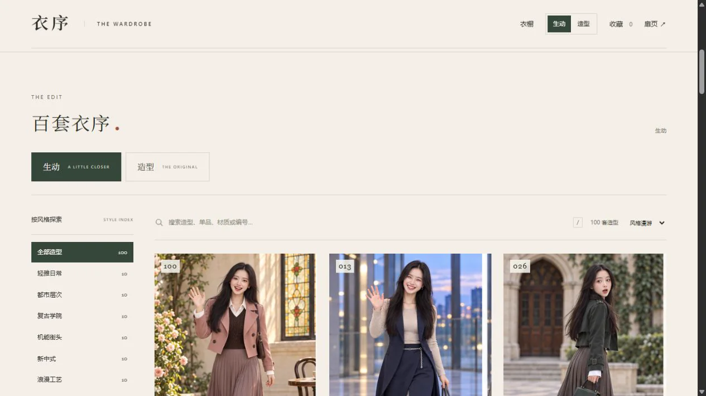

# Yixu Wardrobe · 衣序

Dress an ordinary moment in something you love.

Yixu is a wardrobe to wander through at your own pace: 100 complete looks across ten style collections. Explore the layers of an outfit, the turn of a silhouette, or a smile that makes you look twice.

[Explore online](https://www.8882088.xyz/) · [简体中文](README.md) · [Repository](https://github.com/ider-zh/yixu-wardrobe)

## Two ways to see a look

**生动 · Expressive** brings out movement, emotion and connection: a walk together, a conversation that turns into laughter, a glance back.

**造型 · Styling** focuses on silhouette, texture and layers, with full-length, side, back and close views.

Switch between them in the header. Open a look to view both photography styles together.

## Take your time choosing

- **Browse by style.** Ten collections, with ten looks each: Everyday Elegance, Urban Layers, Vintage Academia, Utility Streetwear, Modern Chinese, Romantic Craft, Occasionwear, Outdoor Utility, Travel and Holiday, and Winter Layers.
- **Choose a season.** Select spring/autumn, summer, winter or all-season with one click. Choose 全部 to see every season.
- **Find what you have in mind.** Search look names, numbers, garments, materials or moods. The gallery labels are in Chinese; try 丝绒 for velvet, 百褶裙 for pleated skirts, or 惊喜 for surprise.
- **Look a little closer.** Open an outfit for its nine-photo grid. Select 01–09 to explore a single moment, then read the garment list and styling notes.
- **Keep your favorites.** Use the heart to save a look, compare two or three outfits, or choose 保存图片 to download its contact sheet.

Keyboard shortcuts: `/` for search, `←` and `→` for adjacent looks in details, and `Esc` to close a dialog.

## Start browsing

Visit the [Yixu online wardrobe](https://www.8882088.xyz/) to browse, filter and save your favorite looks.

To browse offline, choose **Code → Download ZIP** on the repository page. Extract the complete folder and open `index.html`.

No account or dependency installation is needed. Keep the extracted files together so the gallery can find its images.

If photos do not appear, check that the whole archive was extracted, rather than copying only the HTML file. The repository's 200 photos are now same-dimension lossy WebP (quality 85, compression level 6): their combined size fell from 531,661,790 to 48,176,224 bytes (about 48.18 MB), a 90.94% reduction, with a maximum of 384,636 bytes per image. This is not the full site size.

The runtime set still contains 206 files. Photos stay alongside the website under the relative paths `images/` and `images-v2/`, with no object storage or external CDN dependency. The documentation preview has also been converted to WebP.

## Your favorites and the images

Favorites stay in the current browser. The gallery does not upload your choices. Changing browsers, opening the gallery from a different address or clearing browser data may remove or separate your favorites.

The character and outfit imagery are generative artwork for styling inspiration and visual enjoyment. Details may vary between photographs.

The website is now live over HTTPS and displays the ICP filing number [浙ICP备2026098002号](https://beian.miit.gov.cn/). HTTP redirects to HTTPS; automated certificate renewal is configured and its rehearsal passed.

[Personal-photo AI try-on and first-party analytics](docs/ai-tryon-backend-design.md) are currently a design only, not a live feature. The current website does not accept selfies.

---

For project structure and further development, see [Development notes](DEVELOPMENT.md).
