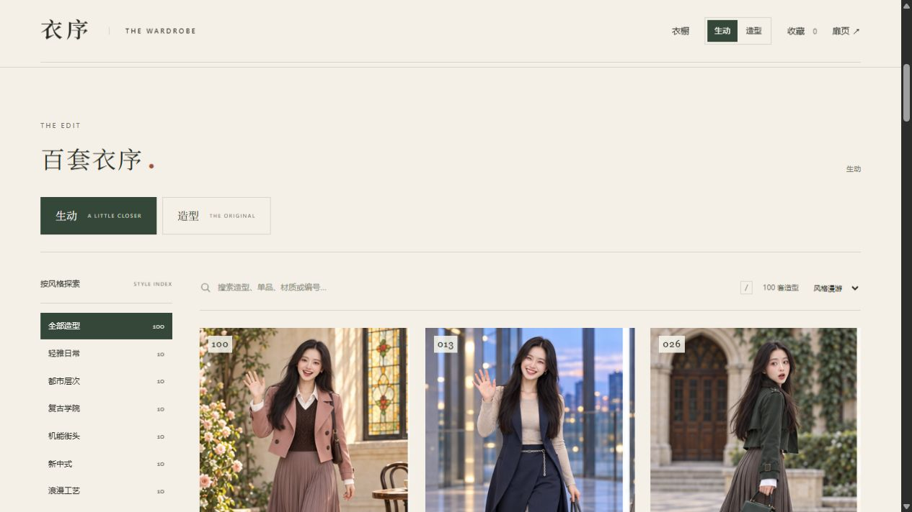

# 衣序 · Yixu Wardrobe

把平常的片刻，穿成喜欢的样子。

衣序是一间可以慢慢逛的线上衣橱。100 套完整搭配，分成 10 组风格；从衣料的层次，到回眸时的笑意，寻找让你想多看一眼的那一套。

[在线浏览](https://yixu-wardrobe.9992099.xyz/) · [English](README.en.md) · [项目仓库](https://github.com/ider-zh/yixu-wardrobe)

## 两种方式，看见一套衣服

**生动**，看笑容、动作与情绪。像一起散步、聊到笑场，或刚好回头看见你。

**造型**，看轮廓、材质与搭配。从全身、侧面、背面到近景，细看每一层衣着。

在页首选择“生动”或“造型”，随时切换；打开一套搭配，还能把两种写真放在一起看。

## 慢慢挑，认真看

- **按风格逛**：轻雅日常、都市层次、复古学院、机能街头、新中式、浪漫工艺、礼服造型、山野机能、度假旅行、冬日叠穿，每组各 10 套。
- **按季节选**：点击春秋、夏季、冬季或四季，一次选中；选“全部”继续看完整衣橱。
- **找到心中那一套**：搜索造型名称、编号、单品、材质或情绪，也可以试试“丝绒”“百褶裙”“惊喜”。
- **走近一个画面**：打开搭配，查看九宫格写真；选择 01—09，细看其中一个瞬间，再读单品与搭配思路。
- **留住喜欢的**：点心形收藏，或把 2—3 套加入对比。想保存写真时，点击“保存图片”。

键盘也能帮忙：`/` 搜索，`←` `→` 切换详情中的搭配，`Esc` 关闭弹窗。

## 开始浏览

打开 [衣序在线衣橱](https://yixu-wardrobe.9992099.xyz/)，即可浏览、筛选和收藏喜欢的搭配。

也可以离线浏览：从仓库页面选择 **Code → Download ZIP**，完整解压后打开 `index.html`。

无需注册或安装依赖。请保留解压后的文件结构，图片与网页需要放在一起。

如果图片没有显示，先确认已完整解压，而不是只复制了网页文件。原图较大，首次加载时可以稍等片刻。

## 关于收藏与画面

收藏留在当前浏览器中，页面不会上传你的选择。换一个浏览器、换一种打开方式或清理浏览数据后，收藏可能不会保留。

人物与服装画面采用生成式创作，供穿搭灵感与视觉欣赏；不同画面中的细节可能略有变化。

---

想了解项目结构或继续制作？请看 [开发说明](DEVELOPMENT.md)。
